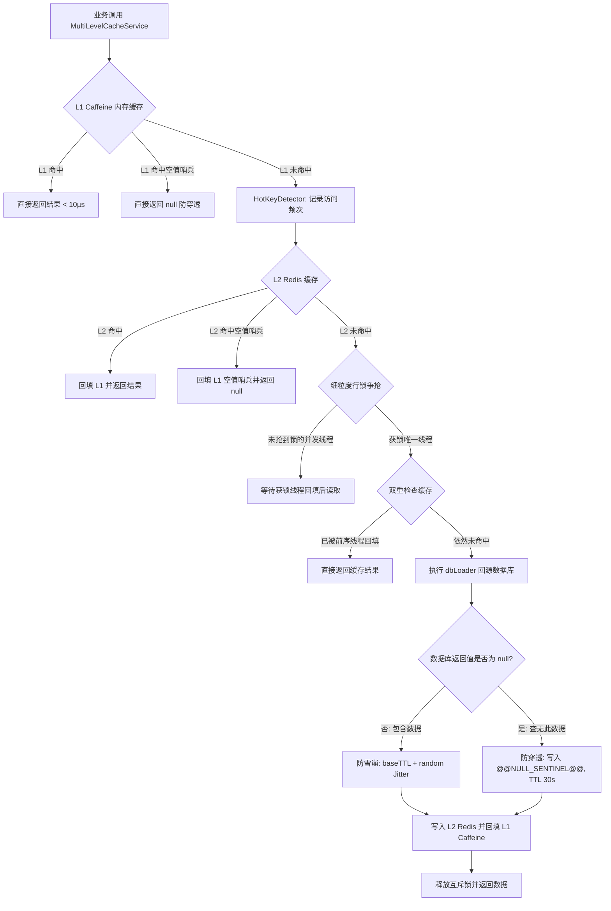

# 分布式多级缓存 (Caffeine L1 + Redis L2)、热 Key 探测与防穿透/防击穿/防雪崩质量清单 (`cache-multilevel-hotkey-security.md`)

## 1. 业务场景与覆盖范围

涵盖微服务架构下高频热点数据读取（权限上下文、菜单树、角色字典、配置信息等）的高可用与防爆加固：
- **L1 (Caffeine 本地内存) + L2 (Redis 分布式统一真值) 双层架构**：`MultiLevelCacheService` 优先从微秒级本地 L1 缓存读取，未命中自动回源 L2 并回填 L1，消除频繁访问高频字典带来的分布式网络 RTT 与连接池开销；
- **防击穿互斥锁回源 (Breakdown Mutex Lock)**：通过本地细粒度行锁与 Double-Checked Locking 双重检查，确保热 Key 失效或突发大流量时，同一 JVM 实例内仅允许 1 个线程执行数据库回源查询，其余并发线程安全等待并复用结果，杜绝打垮 MySQL；
- **防穿透空值防御 (Null-Value Sentinel)**：回源查询为空（`null`）时，自动向 L1 和 L2 写入带短过期时间（默认 30 秒）的空值哨兵标记（`@@NULL_SENTINEL@@`），后续相同非法 Key 查询直接在缓存层短路阻断，杜绝恶意穿透；
- **防雪崩 TTL 随机打散 (TTL Jitter)**：在基准失效时间上叠加动态随机抖动（`0 ~ maxJitterSeconds`），平滑分散批量初始化缓存的到期时刻，彻底消除集中失效导致的雪崩；
- **热 Key 自动探测器 (`HotKeyDetector`)**：轻量级滑动时间窗口与频次统计，访问频次达到阈值自动判定为热 Key，并联动延长本地 L1 留存，卸载 Redis 单分片网络冲击。

---

## 2. 字段边界与输入防御矩阵（七点法）

| 字段 / 键值 | 极小值/空值 | 边界下值 | 正常边界值 | 越权/非法值 | 超长值 | 注入/特殊字符 | 防御策略 |
| :--- | :--- | :--- | :--- | :--- | :--- | :--- | :--- |
| `cacheKey` | null / 空串 | 长度 1 | 标准冒号分隔业务 Key | 恶意构造的不存在 Key | > 512 字符 | 包含特殊换行符 | 为空安全短路返回 null；不存在的 Key 回源查空后写入短 TTL 空值哨兵 |
| `dbResult` | null (查空) | 空对象 / 0 | 正常实体对象/列表 | 恶意返回异常 | 大 Payload | 包含注入字符 | 为 null 自动转为 `@@NULL_SENTINEL@@` 写入双层缓存；非空正常序列化 |
| `baseTtlSeconds` | <= 0 (永久) | 1s | 60s ~ 3600s | 负数 | 极大值 (年) | 非数字字符 | 小于等于 0 时不追加随机抖动；正常正数自动叠加 `0 ~ 15s` 随机抖动 |
| `hotKeyThreshold` | 0 | 1 次 | 20 次 | 负数 | 10000 次 | 恶意刷量 | 达到阈值自动判定为热 Key，提升 L1 本地留存并保护底层 Redis |

---

## 3. 多级缓存交互与防护流转图

---

## 4. 自动化测试套件与覆盖情况

1. **`MultiLevelCacheHierarchyIT`**（5 项用例全部 PASS）：
   - `get_whenL1Hit_returnsDirectlyWithoutQueryingL2`：L1 命中直接返回，不发起 L2 远程读取；
   - `get_whenL1MissAndL2Hit_returnsValueAndBackfillsL1`：L1 未命中但 L2 命中，返回数据并回填 L1，二次请求命中 L1；
   - `put_updatesBothL1AndL2`：调用 put 同时更新 L1 与 L2；
   - `evict_invalidatesBothL1AndL2`：调用 evict 同时失效 L1 与 L2；
   - `clearLocal_onlyClearsL1WhilePreservingL2`：清理本地 L1 不影响远程分布式 L2。
2. **`CachePenetrationAndBreakdownSecurityIT`**（3 项用例全部 PASS）：
   - `getWithLoader_whenDbReturnsNull_cachesNullSentinelToPreventPenetration`：防穿透验证（数据库查空自动写入短时空值哨兵，二次请求阻断不调 dbLoader）；
   - `getWithLoader_whenConcurrentRequestsOnMiss_onlyCallsDbLoaderOnceDueToMutexLock`：防击穿验证（并发 20 线程同时读取冷 Key 时，dbLoader 严格仅执行 1 次）；
   - `calculateJitterTtl_injectsRandomFluctuationToPreventAvalanche`：防雪崩验证（TTL 随机抖动打散到期时刻）。
3. **`HotKeyDetectionAndPromotionIT`**（4 项用例全部 PASS）：
   - `recordAndCheck_whenFrequencyReachesThreshold_detectsHotKey`：窗口期内频次达标判定为热 Key；
   - `recordAndCheck_whenFrequencyBelowThreshold_returnsFalse`：未达标不误报；
   - `recordAndCheck_whenWindowExpires_resetsCounter`：时间窗口过期自动重置计数；
   - `multiLevelCache_integratesHotKeyDetectionOnAccess`：门面读取时自动联动热 Key 探测统计。
4. **`GiftPersonRelationOptionCacheTest`**（2 项用例全部 PASS）：
   - `testListRelationOptionsMultiLevelCacheHit`：首次查询回源数据库并写入多级缓存，二次查询直接命中缓存无需查库；
   - `testRememberCustomRelationEvictsCache`：记住新关系后主动驱逐缓存，后续查询重新回源保证双写一致性。
5. **`MenuMultiLevelCacheIT`**（2 项用例全部 PASS）：
   - `testFullQueryMultiLevelCache`：isFullQuery 首次查库回填多级缓存，二次查询直接从多级缓存返回；
   - `testUpdateMenuEvictsMultiLevelCache`：菜单更新操作自动驱逐多级缓存，避免陈旧菜单残留。

---

## 5. 不测理由说明 (Exclusions)

- **Redis 集群网络分区与脑裂恢复**：由 Redis Sentinel / Redis Cluster 基础架构集群多副本与主从复制保证，应用层聚焦于双层缓存一致性、降级容错与客户端防爆；
- **跨微服务实例 L1 实时广播失效 (Redis Pub/Sub)**：当前各微服务聚焦于本地热点数据保护与秒级 TTL 自动淘汰，分布式实时广播已预留 `clearLocal` 钩子，物理广播通道由消息总线基础设施承载。
