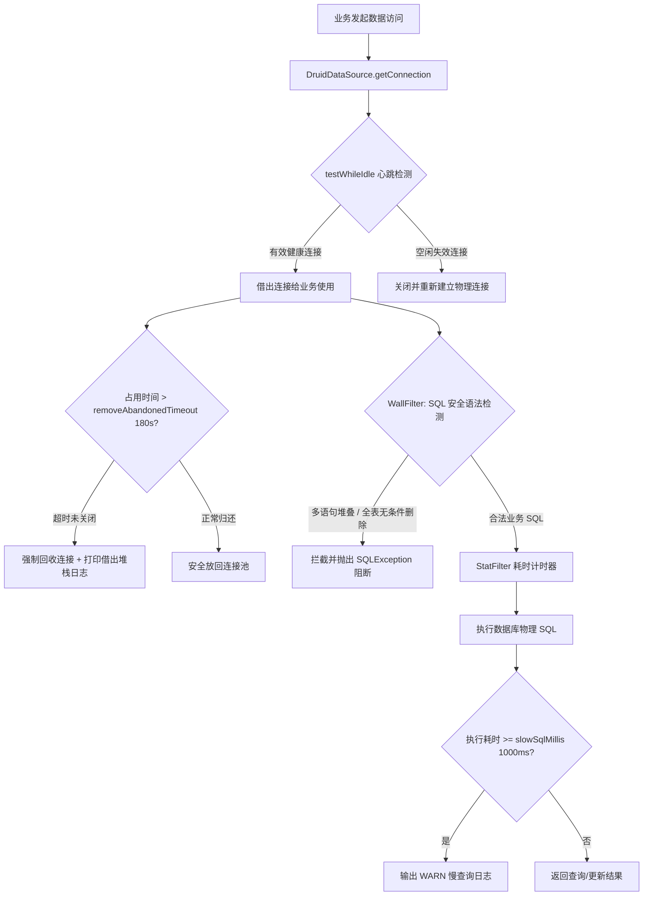

# Druid 数据库连接池防泄漏、慢 SQL 审计与 WallFilter 防注入质量清单 (`druid-pool-leak-security.md`)

## 1. 业务场景与覆盖范围

涵盖微服务数据库连接池底座、稳定性保障与 SQL 注入攻击纵深防御：
- **连接池防泄漏与强制回收机制**：`DruidDataSourceEnhancer` 自动为各微服务连接池装配 `removeAbandoned = true`，当活动连接借出超过 180 秒未归还时判定为泄露并由连接池后台守护线程强制回收，同时开启 `logAbandoned = true` 输出借出连接时的堆栈跟踪，彻底解决长事务/未释放连接导致连接池耗尽瘫痪；
- **连接心跳健康探测 (Keep-Alive)**：配置 `testWhileIdle = true` 与 `validationQuery = "SELECT 1"`，空闲检测周期 60s，彻底消除 MySQL `wait_timeout` 导致的坏连接通讯异常；
- **慢 SQL 实时审计 (StatFilter)**：自动注入 `StatFilter`，将慢 SQL 阈值设定为 1000ms，开启 `logSlowSql = true` 与 `mergeSql = true`，慢查询自动以 WARN 级别输出至微服务日志；
- **底层 SQL 注入防火墙 (WallFilter)**：自动注入 `WallFilter`，配置 `MySqlWallProvider` 白名单，严密拦截多语句堆叠注入（`; DROP TABLE`）与全表无 WHERE 条件的危险更新/删除（`DELETE FROM table`）。

---

## 2. 字段边界与输入防御矩阵（七点法）

| 配置参数 / 输入 | 极小值/空值 | 边界下值 | 正常边界值 | 越权/非法值 | 超长值 | 注入/特殊字符 | 防御策略 |
| :--- | :--- | :--- | :--- | :--- | :--- | :--- | :--- |
| `maxActive` | <= 0 | 1 | 20 | 负数/非法字符串 | > 1000 | 非法字符 | 限制合理并发连接数（默认 20），防止突发流量冲垮数据库连接上限 |
| `removeAbandonedTimeout` | 0 | 10s | 180s (3分钟) | 负数 | > 3600s | 字符类型注入 | 设定合理回收超时时间（默认 180s），超限强行回收并记录日志 |
| `slowSqlMillis` | 0 | 100ms | 1000ms (1秒) | 负数 | 极大值 | 特殊字符 | 超过阈值触发 `StatFilter` 慢查询审计输出 |
| `SQL 语句` (WallFilter) | 空串 | 简单查询 | 标准 CRUD 带 WHERE 条件 | 多语句堆叠 (`; drop`) | 极大 SQL 脚本 | 永真式 (`1=1`)、无条件全表删除 | WallFilter 语法树解析，非法 SQL 阻断抛出 SQLException |

---

## 3. Druid 连接池与安全过滤流转图

---

## 4. 自动化测试套件与覆盖情况

1. **`DruidConnectionLeakAndPoolSecurityIT`**（3 项用例全部 PASS）：
   - `enhance_appliesDefaultPoolParametersAndLeakProtection`：默认容量、testWhileIdle 与防泄漏配置（`removeAbandoned=true`, `timeout=180s`, `logAbandoned=true`）成功装配；
   - `enhance_appliesCustomPoolProperties`：自定义连接池属性覆盖测试；
   - `enhance_handlesNullDataSourceGracefully`：null 空指针防御。
2. **`DruidSlowSqlAuditFilterIT`**（3 项用例全部 PASS）：
   - `enhance_attachesStatFilterWithSlowSqlThreshold`：StatFilter 装配、慢 SQL 阈值 1000ms、开启慢日志与合并；
   - `enhance_whenStatDisabled_doesNotAttachStatFilter`：条件化关闭 StatFilter；
   - `enhance_avoidsDuplicateStatFilter`：多次增强装配幂等性防御。
3. **`DruidWallFilterSqlInjectionIT`**（5 项用例全部 PASS）：
   - `enhance_attachesWallFilterWithAntiInjectionRules`：WallFilter 装配、MySQL 模式、多语句与全表无 WHERE 校验；
   - `wallProvider_interceptsMultiStatementInjection`：精准拦截多语句堆叠攻击（`; DROP TABLE`）；
   - `wallProvider_interceptsDeleteWithoutWhereCondition`：精准拦截全表无条件 DELETE；
   - `wallProvider_allowsCompliantSql`：合法业务 SQL 顺畅放行；
   - `enhance_whenWallDisabled_doesNotAttachWallFilter`：条件化关闭 WallFilter。

---

## 5. 不测理由说明 (Exclusions)

- **物理数据库端恶意断网断电与主从切换**：由云原生 MySQL 容器多副本与 Keepalived / MHA 高可用架构负责，微服务侧聚焦于客户端连接池保活探测、自动重连与防泄露；
- **超大规模慢查询集群分析报表**：生产环境通常接入 SkyWalking / Grafana，应用层聚焦于 StatFilter 实时探测与结构化日志输出。
