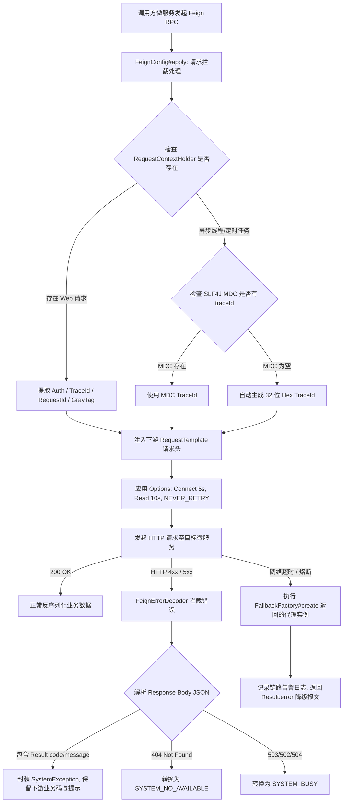

# 微服务间 Feign 远程调用熔断降级、请求头 TraceId 透传与防呆质量清单 (`feign-trace-fallback-security.md`)

## 1. 业务场景与覆盖范围

涵盖微服务间基于 Spring Cloud OpenFeign 相互 RPC 调用的核心底座、链路追踪与容错防护：
- **TraceId 与灰度标签全链路透传**：`FeignConfig` 自动提取当前请求的 `X-Trace-Id`、`X-Request-Id`、`X-Gray-Tag`、`X-Route-Tag` 与 `Authorization`，下游无缝注入；异步线程/定时任务下基于 `MDC` 提取；无凭据下自动生成 32 位 Hex TraceId 保底闭环；
- **Feign 超时与非幂等重试防呆**：默认连接超时 5s、读取超时 10s；显式配置 `Retryer.NEVER_RETRY`，防止下游网络抖动或服务故障时盲目自动重试非幂等业务；
- **微服务统一错误响应解码器**：`FeignErrorDecoder` 解析下游返回的结构化 `Result` JSON，智能提取下游业务 `code` 与 `message` 封装为 `SystemException`，并在 404/503 时映射为规范错误码；
- **各微服务 FallbackFactory 契约规范重构**：修复 `user_api`、`finance_api`、`oss_api` 中误将 `fallback` 配置为 `FallbackFactory.class` 且在 `create()` 内部粗暴抛错的问题，规范返回代理实例并在降级调用时返回结构化 Result 或记录链路告警。

---

## 2. 字段边界与输入防御矩阵（七点法）

| 字段/请求头 | 极小值/空值 | 边界下值 | 正常边界值 | 越权/非法值 | 超长值 | 注入/特殊字符 | 防御策略 |
| :--- | :--- | :--- | :--- | :--- | :--- | :--- | :--- |
| `X-Trace-Id` | 未携带/null | 长度 1 | 32位 UUID Hex 串 | 畸形或混淆 TraceId | 长度 > 128 | 换行符 / `\r\n` | 优先取当前 HTTP 请求头；为空从 MDC 取；仍为空自动生成 32 位 Hex |
| `Authorization` | 未携带/null | "Bearer " | 合法 JWT 字符串 | 伪造 Token | 超长密文 | 特殊控制字符 | 仅在非空时原样透传，无 Servlet 上下文时不注入空头 |
| `X-Gray-Tag` | 未携带/null | "default" | "gray" / "canary" | 恶意标签 | > 64 字符 | 路径穿越字符 | 非空时向下游透传，协同网关完成流量染色与灰度服务发现路由 |
| `下游 HTTP Body` | 空/null | "{}" | `{"code":"60005","message":"..."}` | HTML 500 页面 | 极大字符串 | 非法 JSON 语法 | 优先尝试 Jackson 解析提取 code/message；非 JSON 安全回退状态码兜底 |

---

## 3. Feign RPC 调用拦截与降级处理流程图

---

## 4. 自动化测试套件与覆盖情况

1. **`FeignTraceIdAndHeaderPropagationIT`**（4 项用例全部 PASS）：
   - `apply_whenHttpServletRequestContainsHeaders_faithfullyPropagatesAll`：Servlet 上下文下 5 大核心请求头保真透传；
   - `apply_whenInAsyncThreadWithoutServletRequest_extractsFromMdc`：异步线程/定时任务从 MDC 自动提取 TraceId；
   - `apply_whenBothServletAndMdcEmpty_generates32HexTraceId`：全空场景保底生成 32 位 Hex TraceId；
   - `apply_whenOnlyAuthorizationPresent_onlyInjectsAuthAndGeneratedTraceId`：部分请求头场景防御。
2. **`FeignTimeoutAndRetrySecurityIT`**（4 项用例全部 PASS）：
   - `options_configuresSafeDefaultTimeouts`：连接超时 5s、读取超时 10s；
   - `retryer_isConfiguredToNeverRetry`：验证 `Retryer.NEVER_RETRY`，抛出 `RetryableException` 绝不重试；
   - `level_isBasic`：验证日志级别为 BASIC；
   - `requestContextListener_instantiatesSuccessfully`：验证 Servlet 请求监听器实例化。
3. **`FeignErrorDecoderIT`**（4 项用例全部 PASS）：
   - `decode_whenDownstreamReturnsStructuredResultJson_extractsCodeAndMessage`：下游错误 JSON 精准提取 code/msg；
   - `decode_whenDownstreamReturns404_returnsSystemNoAvailable`：下游 404 映射；
   - `decode_whenDownstreamReturns503_returnsSystemBusy`：下游 503 映射；
   - `decode_whenDownstreamReturnsHtmlOrPlainText_fallsBackSafely`：非 JSON 文本安全降级。
4. **`UserFallbackFactoryIT`**（5 项用例全部 PASS）：
   - `userFallbackFactory_returnsSafeProxyWithErrorCode`：验证 UserFallbackFactory 返回非空代理，调用返回标准化降级错误码；
   - `menuInfoFallbackFactory_returnsSafeProxyWithErrorCode`：MenuInfoFallbackFactory 降级验证；
   - `orgFallbackFactories_returnSafeProxiesWithErrorCode`：OrgInfo 与 OrgUserInfo 降级验证；
   - `roleFallbackFactories_returnSafeProxiesWithErrorCode`：Role 领域（RoleInfo/RolePermission/RoleUser）降级验证；
   - `permissionInfoFallbackFactory_returnsSafeProxyWithErrorCode`：PermissionInfo 降级验证。

---

## 5. 不测理由说明 (Exclusions)

- **外部真实微服务进程网络拉起**：微服务间 RPC 通信由 Feign 客户端拦截器、错误解码器与 FallbackFactory 代理保证，测试环境不启动真实的全部远程微服务进程；
- **Sentinel Dashboard 控制台可视化推流**：Sentinel 规则可通过本地配置加载，不依赖远程 Sentinel Dashboard 服务器连通性。
