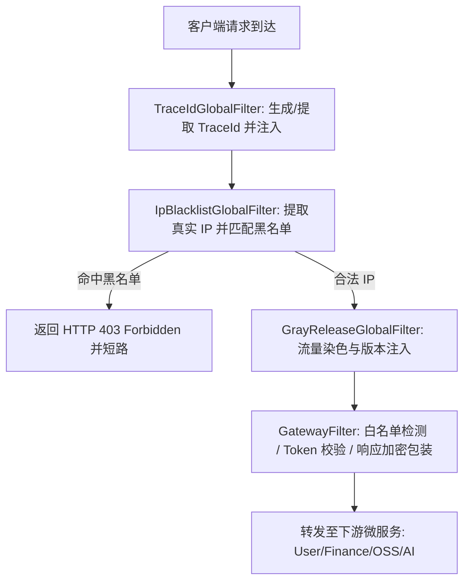

# 网关微服务全局灰度发布路由、黑名单 IP 动态拦截与跨微服务链路追踪（TraceId）质量清单 (`gateway-routing-trace-security.md`)

## 1. 业务场景与覆盖范围

涵盖 `alex_miaosha_gateway` 网关微服务的核心入口流量调度、安全防护与分布式观测性：
- **TraceId 全链路追踪**：`TraceIdGlobalFilter` 自动生成、下游注入与对外响应头回写；
- **IP 黑名单动态拦截**：`IpBlacklistGlobalFilter` 真实 IP 提取（兼容多级代理）、CIDR/通配符封禁、HTTP 403 快速短路；
- **全局灰度发布路由**：`GrayReleaseGlobalFilter` 基于请求头/版本号的流量染色、`X-Route-Tag` 负载均衡元数据透传与平滑兜底。

---

## 2. 字段边界与输入防御矩阵（七点法）

| 字段 | 极小值/空值 | 边界下值 | 正常边界值 | 越权/非法值 | 超长值 | 注入/特殊字符 | 防御策略 |
| :--- | :--- | :--- | :--- | :--- | :--- | :--- | :--- |
| `X-Trace-Id` | 未携带/空串 | 长度 1 | 32位 UUID Hex 串 | 非法乱码或格式错误 | 长度 > 128 | SQL/换行注入符 | 为空时网关自动生成高熵 32 位 Hex，忠实透传合规值 |
| `clientIp` | 未能获取/null | "unknown" | 标准 IPv4 / IPv6 | 黑名单单 IP / 通配网段 | 畸形 IP 字符串 | 伪造多级代理头 | 准确提取 `X-Forwarded-For` 首个真实 IP，命中黑名单立即 403 阻断 |
| `X-Gray-Tag` | 未携带/空串 | "default" | "gray" / "v2.5.0" | 恶意染色请求 | 长度 > 64 | 路径穿越字符 | 规范染色并注入 `X-Route-Tag` / `X-Service-Version`，未命中默认回退 `default` |

---

## 3. 网关前置过滤器链路与状态机

---

## 4. 自动化测试套件与覆盖情况

1. **`GatewayTraceIdPropagationIT`**（4 项用例全部 PASS）：
   - `filter_whenTraceIdMissing_generatesUniqueTraceIdAndPropagates`：未传时自动生成 32 位唯一 TraceId 并透传；
   - `filter_whenTraceIdProvided_faithfullyPropagatesExisting`：携带合规 TraceId 时原样透传；
   - `filter_whenRequestIdProvided_usesRequestIdAsTraceId`：兼容 `X-Request-Id`；
   - `order_isHighestPrecedence`：验证最高优先级 `Ordered.HIGHEST_PRECEDENCE`。
2. **`GatewayIpBlacklistSecurityIT`**（6 项用例全部 PASS）：
   - `filter_whenIpInBlacklist_blocksWith403AndShortCircuits`：单 IP 黑名单命中拦截与短路；
   - `filter_whenIpMatchesWildcardPattern_blocks`：通配符前缀（`10.0.0.*`）匹配拦截；
   - `filter_whenIpNotInBlacklist_proceedsNormally`：合法 IP 正常放行；
   - `filter_resolvesRealIpFromXForwardedForMultiProxy`：多级反向代理首个真实 IP 提取与封禁；
   - `filter_whenIpBlacklistEmpty_allowsAll`：空配置防御；
   - `order_isImmediatelyAfterTraceId`：优先级验证（`HIGHEST_PRECEDENCE + 1`）。
3. **`GatewayGrayReleaseRoutingIT`**（5 项用例全部 PASS）：
   - `filter_whenGrayTagPresent_injectsGrayRouteAndVersion`：默认灰度标签染色；
   - `filter_whenSpecificVersionTagPresent_injectsCustomVersion`：具体版本号染色透传；
   - `filter_whenNoGrayTag_injectsDefaultTag`：未携带时平滑降级为 `default`；
   - `filter_whenCustomHeaderConfigured_resolvesCustomHeader`：自定义灰度请求头解析；
   - `order_isEarlierThanAuth`：优先级先于常规业务过滤器验证。

---

## 5. 不测理由说明 (Exclusions)
- **网关物理层 DDOS/SYN Flood**：由云厂商 CDN 与基础架构硬件防火墙防护，网关层聚焦于应用层 IP 黑名单与限流；
- **底座 Nacos 注册中心网络闪断重连**：由 Spring Cloud Alibaba Nacos Client 内置心跳机制保证。
