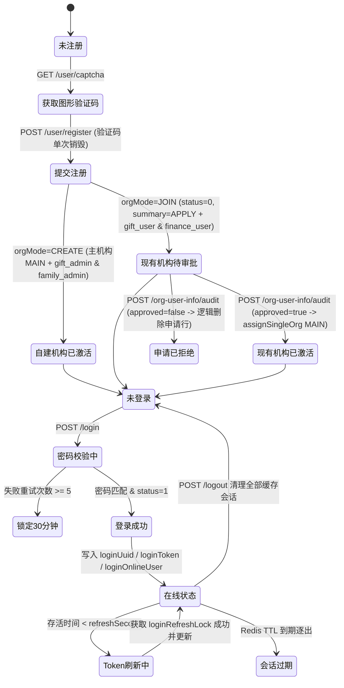

# 用户认证、Token 刷新与在线生命周期安全质量清单 (`user-auth-security.md`)

## 1. 业务场景与覆盖范围

涵盖 `alex_miaosha_user` 服务的核心身份认证、Token 异步刷新、会话生命周期与密码安全防御：
- **Token 刷新**：`TokenRefreshService.refreshTokenAsync` 临近过期刷新、并发防雪崩锁；
- **在线会话管理**：`OnlineUserService` 秒级过期时间计算防失真（纠正 `MICROS` -> `SECONDS`）；
- **登出联动**：`TUserServiceImpl#logout` 原子清理 `loginUuid`、`loginToken` 与 `loginOnlineUser`；
- **密码安全**：`updateTUser` 忽略明文 `password` 防篡改，新增 `resetUserPassword` 强校验与盐值加密；
- **认证契约**：账号禁用（`status=0`）拦截、密码错误累计锁定（5次/30分钟）、空参防御；
- **手机号注册与机构入驻/申请闭环**：图形验证码防刷（单次消费 + 120s 过期）、自建机构自动赋权（`gift_admin` + `family_admin`）、申请加入现有机构（`t_org_user_info: status=0, summary=APPLY` + 默认 `gift_user` + `finance_user`）及机构管理员在成员抽屉审批通过/拒绝。

---

## 2. 字段边界与输入防御矩阵（七点法）

| 字段 | 极小值/空值 | 边界下值 | 正常边界值 | 越权/非法值 | 超长值 | 注入/特殊字符 | 防御策略 |
| :--- | :--- | :--- | :--- | :--- | :--- | :--- | :--- |
| `username` | `null` / `""` | 长度 1 | 常规用户名/邮箱/手机号 | 禁用用户状态 | 长度 > 64 | SQL/XSS 符号 | 抛出 `USER_USERNAME_OR_PASSWORD_EMPTY`，状态限定为 `ENABLE` |
| `password` | `null` / `""` | 长度 5 | 长度 $\ge 6$ 位强口令 | 明文覆盖已有密文 | 长度 > 128 | 空格串 `"   "` | `resetUserPassword`/`register` 强校验 $\ge 6$，`updateTUser` 显式忽略 |
| `mobile` (注册) | `null` / `""` | 10位数字 `1380013800` | 11位手机号 `13800138000` | 非1开头/含字母/已注册手机号 | 12位数字 | `' OR 1=1 --` | 正则 `^1[3-9]\d{9}$` 强校验 + `judgeField` 唯一性防重 |
| `captchaCode` | `null` / `""` | 3位字符 | 4位图形验证码(忽略大小写) | 错误验证码/已消费/已过期 | 长度 > 8 | 特殊符号 | Redis `LoginKey.loginCaptcha` 校验后立即 `delete` 单次消费 |
| `orgMode` | `null` / `""` | `"OTHER"` | `"CREATE"` / `"JOIN"` | 伪造未知模式 | 长度 > 16 | 脚本注入 | 仅允许 `CREATE` 或 `JOIN`，其余抛 `PARAM_ERROR` |
| `orgName` (自建) | `null` / `""` | 1个字符 | 2~32个字符 | 空白串 `"   "` | 长度 > 64 | HTML标签 | `CREATE` 模式下必填且长度 2~32，自动生成唯一 `orgCode` |
| `targetOrgId` (加入) | `null` | `0` / `-1` | 有效 19 位雪花机构ID | 不存在或已停用机构ID | 越界数值 | 非数字字符 | `JOIN` 模式下校验目标机构存在且 `status=1`，前端字符串化防精度丢失 |
| `uuidToken` | `null` / `""` | "undefined" | UUID-v4 字符串 | 任意伪造 TokenId | 长度 > 128 | 跨站请求伪造 | `logout` 拦截无效 Token 返回 `PARAM_ERROR`，阻断误删 |
| `newPassword`| 空白字符串 | 5位字符 | 6位及以上字符 | 绕过权限修改他人密码 | 256字符 | 特殊符号支持 | `assertUserAccessible` 数据权限校验，BCrypt 加盐散列 |

---

## 3. 状态机与会话流转规范

---

## 4. 权限矩阵

| 接口 / 操作 | 超级管理员 (`SUPER`) | 机构管理员 (`ORG_ADMIN`) | 普通用户 (`USER`) | 未认证请求 |
| :--- | :---: | :---: | :---: | :---: |
| 获取图形验证码 (`GET /user/captcha`) | 放行 | 放行 | 放行 | 放行 (白名单) |
| 获取公开可申请机构 (`GET /user/register/orgs`) | 放行 | 放行 | 放行 | 放行 (白名单) |
| 手机号注册 (`POST /user/register`) | 放行 | 放行 | 放行 | 放行 (白名单 + IP限流) |
| 查询机构待审批申请 (`GET /org-user-info/pending`) | 全系统放行 | 仅限本机构及子机构 | 禁止越权操作 | 401 Unauthorized |
| 审批机构入驻申请 (`POST /org-user-info/audit`) | 全系统放行 | 仅限本机构及子机构 | 禁止越权操作 | 401 Unauthorized |
| 用户资料更新 (`updateTUser`) | 全系统放行 (忽略密码) | 仅本机构用户 (忽略密码) | 仅本人资料 (忽略密码) | 401 Unauthorized |
| 重置用户密码 (`resetUserPassword`) | 允许重置全员密码 | 仅限本机构归属用户 | 禁止越权操作 | 401 Unauthorized |
| 用户主动登出 (`logout`) | 仅清理自身 Token | 仅清理自身 Token | 仅清理自身 Token | 400 PARAM_ERROR |
| Token 异步刷新 (`refreshTokenAsync`) | 自动延期 (锁防重) | 自动延期 (锁防重) | 自动延期 (锁防重) | 401 Unauthorized |

---

## 5. 自动化测试套件与覆盖情况

1. **`UserTokenAndOnlineLifecycleIT`**（6 项测试用例全部 PASS）：
   - `onlineUserService_buildAdmin_expireTimeInSeconds`：验证秒级 `SECONDS` 过期时间累加；
   - `logout_cleansUuidTokenAndOnlineUser`：验证登出联动清理三大 Redis 登录键；
   - `logout_withInvalidOrMissingToken_returnsParamError`：验证非法 Header 防呆拦截；
   - `tokenRefresh_whenExpiringSoon_triggersRefreshAndSetsLock`：验证刷新时效判定与互斥锁加锁；
   - `tokenRefresh_concurrentCalls_blockedByLock`：验证并发防重刷与旧 Token 防误删；
   - `tokenRefresh_survivalTimeAmple_skipsRefresh`：验证存活时间充裕时的静默跳过。
2. **`UserPasswordSecurityAndOwnershipIT`**（5 项测试用例全部 PASS）：
   - `updateTUser_ignoresPlaintextPassword_neverOverwritesWithPlaintext`：验证常规资料更新不覆盖密码；
   - `resetPassword_superAdmin_encodesWithSaltAndInvalidatesContext`：验证加盐散列与上下文失效；
   - `resetPassword_weakOrBlankPassword_rejected`：验证空密码与小于6位弱密拦截；
   - `resetPassword_nonExistentUser_rejected`：验证不存在用户的防呆拦截；
   - `resetPassword_orgAdminAccessCrossOrg_rejected`：验证机构管理员跨租户/跨机构越权拦截。
3. **`UserAuthenticationContractIT`**（3 项测试用例全部 PASS）：
   - `login_blankUsernameOrPassword_rejected`：验证空参拦截；
   - `login_exceedMaxRetryLimit_rejected`：验证连续错误锁定；
   - `login_disabledAccount_rejected`：验证禁用账号拦截与重试计数累加。
4. **`UserRegisterAndOrgApplyTest`**（覆盖注册、图形验证码与机构申请审批全流程）：
   - `captcha_generatesBase64ImageAndStoresInRedis`：验证图形验证码生成与 Redis 写入；
   - `register_createOrgMode_createsOrgBindsMainAndAssignsAdminRoles`：验证自建机构自动绑定 MAIN 并授予 `gift_admin` + `family_admin`；
   - `register_joinOrgMode_createsPendingApplyAndAssignsUserRoles`：验证加入已有机构写入 `status=0, summary=APPLY` 并授予 `gift_user` + `finance_user`；
   - `register_invalidCaptchaOrMobileOrPassword_rejected`：验证验证码错误/重放、手机号非法/已存在、弱密码七点法边界拦截；
   - `auditOrgApplication_approveAndReject_updatesOrgBindingAndInvalidatesCache`：验证机构管理员审批通过激活 MAIN 归属与审批拒绝清理。

---

## 6. 不测理由说明 (Exclusions)
- **前端原生密码输入强度评分组件**：由 PC 端与移动端基于正则在端侧校验，后端聚焦于长度、空值、越权与加盐安全底线；
- **第三方 OAuth 回调网络重试**：由 JustAuth 第三方 SDK 保障，本服务已在 Unit/Mock 层完成状态机闭环。
